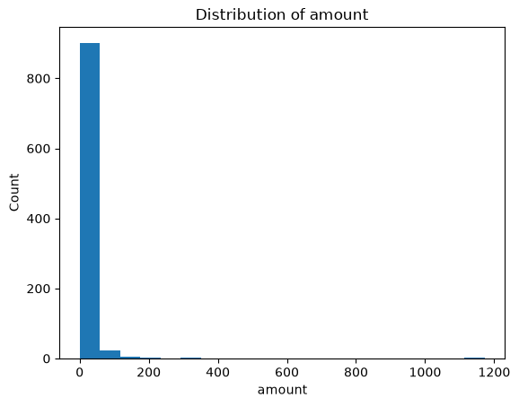
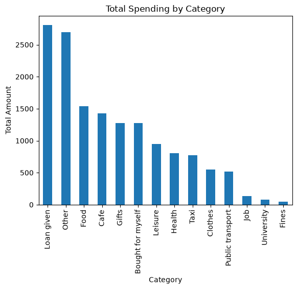
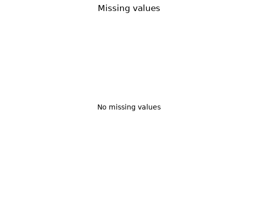

# Project Documentation

> Use this hosted documentation site to tell your
> data story. Include a narrative telling your
> results, observations, and interpretations.
> Display visuals as needed for a compelling story.

## Professional Workflow

See [**Workflow B: Apply Example Project**](https://denisecase.github.io/pro-analytics-02/workflow-b-apply-example-project/)
to get a project like this running on your machine.

## Professional Projects

- We code like the pros to help us **focus on the analytics**.
- Most files in this repository will never be touched.
- If curious about a file, check out the
  [Professional Python Project Explainer](https://denisecase.github.io/professional-python-project-explainer/).

## Documentation Index

- **Home** - this landing page
- [**Project Instructions**](./project-instructions.md)
- [**Concepts**](./concepts.md)
- [**Data Card**](./data-card.md)
- [**API**](./api.md)

## Additional Project Pages

- [**Resources**](./resources.md)
- [**Seaborn Datasets**](./seaborn-datasets.md)
- [**Troubleshooting**](./troubleshooting.md)

## Produced Artifacts

- - [**Jupyter Notebook**](https://github.com/praiholl/datafun-04-eda/blob/main/notebooks/eda_holly.ipynb)
- [**Data Card**](./data-card.md)

## Initial Results

The personal finance dataset contains 938 expense transactions across 14 categories. No missing values were found, although 145 duplicate rows were detected.

Most transactions were relatively small. The median transaction amount was 2, and 75% of transactions had an amount of 10 or less.

Public transport was the most frequent expense category, but it did not account for the greatest total spending. Loan given had the highest total spending, followed by Other.

